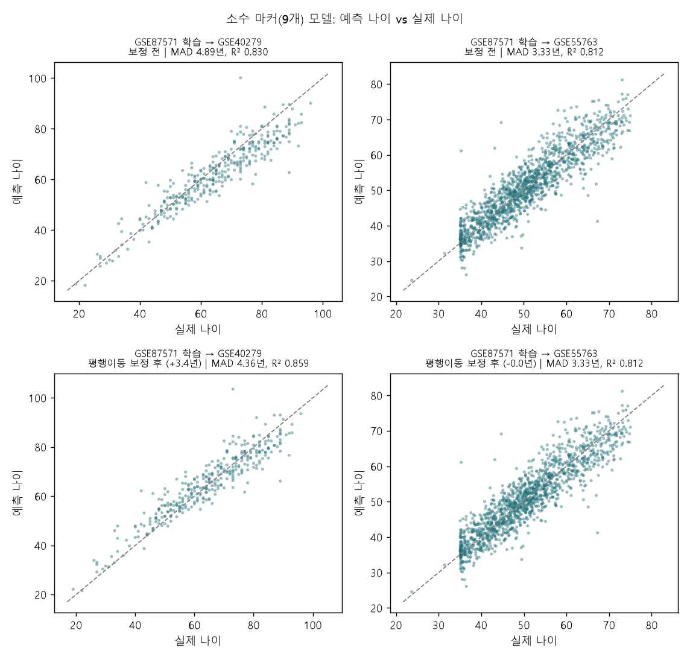
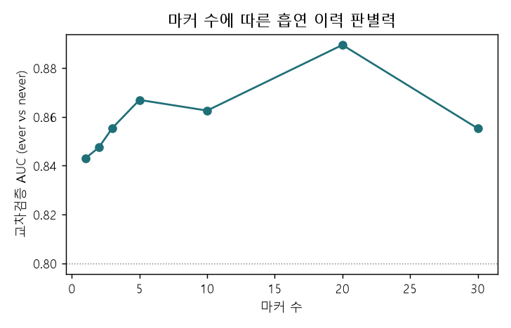

# 마커 9개로 생체나이를 팔 수 있을까?
### 공개 데이터 4,000여 명으로 검증한 소비자 노화 검사의 "팔 수 있는 것"과 "팔면 안 되는 것"

> **공개용 재구성 버전입니다.** 실제 업무 분석을 공개 GEO 데이터 범위로 다시 정리했습니다. 최종 모델의 마커 구성과 계수, 회사 실험 데이터, 미출시 상품 정보는 포함하지 않습니다. 원래 작업과 달라진 점은 [공개용으로 일부 수정됨](docs/public_version_notes.md)에 적었습니다.
> 이 문서의 수치는 모두 최종 모델(마커 9개)을 **공개 데이터에 적용한 결과**이며, 회사 상품의 실측 성능이 아닙니다. 상품은 **출시 준비 중**입니다(2026-11 기준).

---

## 한눈에 보기

헬스케어 기업에서 DNA 메틸화로 "생체나이"를 알려주는 소비자용 노화 검사를 개발했습니다. 비용 때문에 측정할 수 있는 마커는 10개 안팎이었습니다. 저는 "**이 제약 안에서 고객에게 무엇을 약속할 수 있는가**"를 데이터로 판단하는 역할을 맡았습니다.

| 질문 | 판단 | 근거 (공개 데이터) | 상품에 미친 영향 |
|---|---|---|---|
| 마커 9개로도 나이를 맞추는가? | **된다** | 다른 코호트 평균 오차 4.41년. 후보 88개를 다 쓰는 모델(4.28년)과 거의 같음 | 소수 마커 패널로 상품화 |
| 칩 제작 문제로 마커를 바꿔야 한다면? | **바꾼 쪽이 더 정확했다** | 제작 불가 2개를 빼고 3개를 넣은 9개가 원래 8개보다 평균 오차 약 1년 감소 (5.39 → 4.41년) | 제약을 반영한 최종 패널 확정 |
| 재검사로 "좋아졌다"를 보여줄 수 있는가? | **개인 단기 판정은 안 된다** | 측정 신뢰도는 우수(ICC 0.957)하지만, 오차만으로 최대 5.63년 차이가 날 수 있음 | 재검사 결과지를 오차 범위와 함께 비교하는 방식으로 제안 |
| 성별·연령대별로 다른 기준이 필요한가? | **필요 없다** | 후보 88개 중 일관된 성별 차이 0개. 특정 연령대 급변 없음 | 모든 고객에게 같은 기준·같은 콘텐츠 |
| 나이 외에 흡연도 보여줄 수 있는가? | **판별은 되지만 보류** | 마커 5개로 흡연 이력 판별 AUC 0.867, 다른 코호트에서 5/5 재현. 비흡연자에게 줄 정보는 없음 | 칩에 마커를 추가해야 하고 비흡연자 정보가 없어 보류 |
| 혈액 대신 타액으로 해도 되는가? | **혈액 모델을 그대로 쓰면 안 된다** | 같은 사람이라도 마커별 혈액·타액 값이 최대 약 10%p 다름. 타액 전용 모델은 한국인 데이터에서 기준 충족 | 타액 전용 모델 + "두 검체 모두 검증 후 출시" 조건 |

---

## 1. 문제: 정확도와 비용의 줄다리기

- 연구용 칩(Illumina 450K)은 한 사람당 약 48만 개 위치를 측정합니다. 소비자 가격에 맞추려면 **10개 안팎만 재는 저가 타깃 칩**을 써야 했습니다.
- 마커가 줄면 정확도가 떨어집니다. "어디까지 줄여도 상품이 되는가"를 먼저 정해야 했습니다.
- 개발 중에는 칩 제조사가 일부 마커를 제작할 수 없다고 알려와, **패널을 다시 짜야 하는 상황**도 생겼습니다.
- 상품 기획 과정에서 "재검사로 변화를 보여주자", "흡연·미세먼지 같은 생활 정보도 넣자", "타액으로도 받자" 같은 아이디어가 나왔습니다. **각 아이디어를 데이터로 검증해 약속할 수 있는 것과 없는 것을 가르는 것**이 핵심 과제였습니다.

## 2. 가설과 판단 기준 (결과를 보기 전에 정함)

결과를 본 뒤에 기준을 바꾸면 원하는 결론에 맞춰 해석하게 됩니다. 그래서 모든 분석에서 판단 기준을 먼저 적고 시작했습니다.

| 가설 | 미리 정한 판단 기준 |
|---|---|
| 나이와 일관되게 연관된 소수 마커가 있다 | 3개 코호트 모두 같은 방향 + 상관 \|r\| ≥ 0.5 |
| 재검사로 개인 변화를 판정할 수 있다 | 기대 변화량 ≥ 최소 검출 변화량(MDC) |
| 특정 연령대에 메틸화 급변 구간이 있다 | 여러 코호트에서 같은 구간이 최대로 나와야 인정 |
| 흡연은 소수 마커로 실용적으로 판별된다 | 다른 코호트에서 재현 + 마커 5개 이하로 AUC ≥ 0.8 |
| 비흡연자 안에도 공통 노출 신호가 있다 | 마커 간 상관이 대조군보다 0.2 이상 높을 것 |
| 타액 모델이 가능하다 | 상관 r ≥ 0.8, 오차 ≤ 6년, 평균 추측보다 50% 이상 개선 |

## 3. 접근

**데이터:** 공개 GEO 데이터 9개 (450K 칩)

| 역할 | 데이터셋 | 규모 |
|---|---|---|
| 혈액 나이 모델 (학습·검증) | GSE87571, GSE40279, GSE55763 | 729명, 656명, 2,664명 |
| 재검사 신뢰도 | GSE55763 technical replicate | 같은 DNA 36쌍 |
| 흡연 (발견·재현) | GSE50660, GSE42861 | 464명, 689명 |
| 타액 (학습·검증·혈액 비교) | GSE78874, GSE92767, GSE130153 | 259명, 54명(한국인), 같은 사람 22쌍 |
| 대기오염 노출 | GSE294810 | 노출값이 공개되지 않아 검증 불가 |

**원칙**
- **다른 코호트로 검증:** 한 코호트로 학습하고 나머지 코호트에서 평가했습니다. 같은 코호트를 나눠 평가하는 것보다 엄격해서, 실제 고객 데이터에 가까운 조건입니다.
- **"재현되지 않음"과 "존재하지 않음"을 구분:** 신호가 안 나오면 데이터 조건(세포 구성, 연령 범위, 단면 설계)을 함께 적었습니다.
- **관찰과 인과를 구분:** "금연하면 회복된다"가 아니라 "전 흡연자는 중간에 위치한다"로만 해석했습니다.

## 4. 결과

### 4-1. 48만 → 88 → 9: 마커 선별과 칩 제약 반영

| 단계 | 남은 CpG |
|---|---|
| 3개 코호트 공통 | 415,846 |
| 3개 코호트 모두 같은 방향 | 174,417 |
| \|r\| ≥ 0.4 | 414 |
| \|r\| ≥ 0.5 (모델 후보) | 88 |
| 유전자당 1개, 상위 (1차 패널) | 8 |
| 칩 제작 불가 2개 제외, 3개 추가 (최종 패널) | **9** |

1차로 고른 8개 중 2개를 칩 제조사가 제작할 수 없다고 알려왔습니다. 남은 6개에 제작 가능한 3개를 더해 다시 학습했고, 이 9개가 최종 패널이 됐습니다. 마커 구성은 공개하지 않습니다.

### 4-2. 마커 9개의 정확도와 보정

| 모델 | 다른 코호트 오차(MAD) 범위 | 평균 | 쓰는 마커 수 |
|---|---|---|---|
| 후보 88개 + ElasticNet | 3.41~5.36년 | 4.28년 | 45~69개 |
| **최종 패널 + 선형회귀** | **3.30~5.77년** | **4.41년** | **9개** |
| 1차 패널(공개 선별) + 선형회귀 | 4.05~6.67년 | 5.39년 | 8개 |
| ElasticNet이 중요하다고 본 상위 9개만 떼어 씀 | 3.70~6.48년 | 5.08년 | 9개 |

- **칩 제약이 오히려 기회가 됐습니다.** 마커를 바꾼 최종 패널이 1차 패널보다 평균 약 1년 정확했고, 마커를 45~69개 쓰는 큰 모델과의 차이는 0.13년에 불과했습니다.
- ElasticNet이 고른 "중요 마커"만 떼어 쓰면, 학습·평가 6개 조합 중 5개에서 원래 ElasticNet보다 나빴습니다. 마커의 중요도는 함께 쓰는 마커 조합에 따라 달라집니다. 그래서 "큰 모델에서 상위 몇 개만 가져오기"는 마커 수를 줄이는 해법이 되지 않습니다.
- 코호트마다 측정 기준점이 조금씩 달라서 **평행이동 보정**을 검토했습니다. 평가 코호트 절반으로 보정값을 구하고 나머지 절반으로 평가했습니다.

| 평가 코호트 (스웨덴 코호트로 학습) | 보정 전 MAD | 보정 후 MAD | R² |
|---|---|---|---|
| 미국 (GSE40279) | 4.89년 | **4.36년** | 0.830 → 0.859 |
| 영국 (GSE55763) | 3.33년 | 3.33년 (보정값 거의 0) | 0.812 |

미국 코호트는 기준점이 달라 보정 효과가 있었고, 영국 코호트는 보정이 필요 없었습니다. **새 집단에 적용할 때는 보정이 필요한지 먼저 확인하는 단계**가 들어가야 한다는 뜻입니다.



### 4-3. 재검사로 "좋아졌다"를 말할 수 있는가

같은 DNA를 두 번 측정한 36쌍으로 측정 신뢰도를 계산했습니다.

| 지표 | 값 | 의미 |
|---|---|---|
| ICC | **0.957** (95% CI 0.923~0.976) | 다시 재도 순위는 거의 그대로 → 우수 |
| SEM | 2.03년 | 한 번 측정할 때마다 따라붙는 오차 |
| **MDC** | **5.63년** | 측정 오차만으로도 두 검사 결과가 이만큼 달라질 수 있음 |

- 생활습관 개선으로 기대할 수 있는 변화는 이보다 작습니다. 그래서 **한 사람의 단기 재검사에서 숫자가 줄었다고 "좋아졌다"고 판정하는 것은 통계적으로 근거가 없습니다.**
- 계수를 줄이는 방법(Ridge, ElasticNet)으로 바꿔도 ICC는 0.957로 그대로였습니다. 모델을 바꾸는 것으로는 해결되지 않는 측정 자체의 한계입니다.
- 이 결과를 근거로, 재검사 결과지는 한 번의 숫자 차이로 판정하지 않고 **오차 범위와 함께 비교해 보여주는 방식**으로 제안했습니다.

### 4-4. 모든 고객에게 같은 기준을 써도 되는가

- **성별:** 후보 88개 중 3개 코호트에서 일관되게 남녀 노화 속도가 다른 마커는 **0개**였습니다. 코호트 간 성별 차이의 상관도 0.11~0.27로 낮아, 성별 차이는 재현되지 않는 잡음에 가까웠습니다.
- **연령대:** "50대에 급변한다"는 가설을 5세 구간으로 확인했습니다. 변화가 가장 큰 구간이 코호트마다 달라서(30대 초반 / 50대 후반→60대 초반 / 60대 후반→70대 초반) **특정 연령대 집중 변화는 재현되지 않았습니다.** 영국 코호트의 30대 초반은 표본이 10명 미만이라 결론에서 제외했습니다.
- → 성별·연령대별 모듈 없이 **모든 고객에게 같은 콘텐츠를 주는 원칙**의 근거가 됐습니다.

### 4-5. 흡연: 판별은 되지만 상품에 넣지 않은 이유

| 항목 | 결과 |
|---|---|
| 나이·성별 보정 후 흡연 관련 CpG | 24,342개 (FDR < 0.05) |
| 다른 코호트 재현 (환자/대조군 보정) | 상위 5개 모두 같은 방향, 유의 |
| 흡연 이력 판별 AUC | 마커 1개 0.843 → **5개 0.867** |
| 전 흡연자의 위치 | 비흡연자 쪽으로 평균 45% (재현 코호트 53%) |



- 마커를 5개보다 늘려도 판별력은 거의 오르지 않았습니다. **흡연은 소수 마커로 충분히 잡힙니다.**
- 그런데 **비흡연자에게 줄 정보가 있는지**도 확인했습니다. 비흡연자 안에서 흡연 마커들이 함께 움직인다면, 간접흡연 같은 공통 노출을 보여줄 수 있기 때문입니다.
  - 처음에는 마커 간 상관이 +0.377로 기준(0.2)을 넘었습니다.
  - 그런데 상위 마커 5개가 실제로는 **3개 구역에 몰려 있었습니다.** 바로 옆에 있는 CpG끼리는 노출과 상관없이 원래 함께 움직입니다.
  - 서로 1Mb 이상 떨어진 5곳으로 다시 고르니 **+0.140으로 기준 미달**이었습니다.
- 대기오염 축은 노출값이 붙은 공개 데이터(GSE294810)를 찾았지만 노출값이 공개되지 않아 **검증할 수 없었습니다.** 문헌에서도 대기오염 연구에서 재현된 신호에 흡연 마커는 없었습니다.
- → 흡연 신호 자체는 확실하지만, 칩에 마커를 추가해야 하고 비흡연자에게는 줄 정보가 없습니다. 그래서 현재 상품 구성에서는 **보류**했습니다.

### 4-6. 타액으로도 검사할 수 있는가

| 확인 | 결과 |
|---|---|
| 같은 사람 혈액 vs 타액 (22쌍) | 마커별 평균 차이 최대 약 10%p, 사람 간 상관 0.13~0.65 |
| 한국인 타액 54명, 교차검증 | r 0.91, MAD 4.71년, 평균 추측 대비 63% 개선 → **기준 충족** |
| 미국 타액 259명, 교차검증 | r 0.72, MAD 5.41년, 31% 개선 → 기준 미충족 (36~88세, 고령에 치우친 분포) |
| 미국 모델 → 한국인에 적용 | **r 0.94**, MAD 6.89년 (평균 +3.4년 치우침) |

- 같은 사람이라도 혈액과 타액의 값이 다르기 때문에 **혈액 모델을 타액에 그대로 쓰면 안 됩니다.**
- 타액 전용 모델은 다른 집단에서도 나이 순서를 잘 맞췄습니다(r 0.94). 다만 평균이 한쪽으로 치우쳐, 실제 적용 전에 보정이 필요합니다.
- → 타액 전용 모델 방향을 제안했고, **혈액·타액 모두 검증을 마친 뒤 출시**하는 조건을 세웠습니다.

## 5. 사업적 의미

| 결정 | 근거 | 효과 |
|---|---|---|
| 소수 마커 패널로 상품화 | 4-1, 4-2 | 저가 칩으로 큰 모델에 가까운 정확도 확보 |
| 칩 제약을 반영한 패널 재구성 | 4-1, 4-2 | 제작 불가 문제를 해결하면서 정확도도 개선 |
| 재검사 결과 표시 방식 제안 | 4-3 | 고객이 측정 오차를 실제 변화로 오해할 위험을 수치로 제시 |
| 공통 콘텐츠 원칙 | 4-4 | 성별·연령별 모듈을 따로 만들 필요 없음 |
| 흡연·대기오염 축 보류 | 4-5 | 근거가 서지 않은 기능에 칩 추가 비용을 쓰지 않음 |
| 타액 전용 모델 + 출시 조건 | 4-6 | 검체 확장의 위험을 출시 전에 관리 |

결과지의 명칭·판정 표현·재검사 결과지 구조 등 **상품 기획 쪽 의사결정**은 [docs/product_decisions.md](docs/product_decisions.md)에 일반화해서 정리했습니다.

## 6. 그로스 관점에서 같은 문제

이 작업에서 쓴 판단 방식은 그로스 실험에서 쓰는 방식과 같습니다.

| 이 프로젝트 | 그로스 실험에서 |
|---|---|
| 결과를 보기 전에 판단 기준 고정 | 실험 전 성공 지표와 기준 사전 등록 (결과 보고 해석 바꾸기 방지) |
| MDC: 측정 오차보다 작은 변화는 판정하지 않음 | MDE(최소 검출 효과): 표본으로 검출할 수 없는 차이는 결론 내지 않음 |
| 다른 코호트로 검증 | 홀드아웃 그룹, 다른 기간·채널에서 재현 확인 |
| 인접 CpG 때문에 부풀려진 상관 발견 | 서로 연결된 지표를 독립 신호로 오해하지 않기 |
| 성별·연령대·검체별로 따로 확인 | 세그먼트별 효과 차이 확인 |
| 칩 제약 속에서 패널 재구성 | 리소스 제약 안에서 성과를 지키는 우선순위 조정 |

## 7. 제 역할과 한계

**역할:** 공개 데이터 수집·전처리, 마커 선별과 모델링, 칩 제약에 따른 패널 재구성, 측정 신뢰도·생활습관 축·검체 확장 검증, 분석 결과를 상품 구조와 결과지 기획으로 연결. 상품 디자인과 웹 개발은 외부 업체가 맡을 예정입니다.

**한계**
- 모든 수치는 공개 450K 데이터 기준입니다. 실제 상품 칩에서의 성능은 별도 실측 검증이 필요합니다.
- 마커 선별에 3개 코호트를 모두 썼기 때문에 교차검증 성능은 다소 낙관적일 수 있습니다. 학습 코호트만으로 선별하는 옵션(`--select-on`)을 함께 넣었습니다.
- 한국인 타액 데이터는 54명·남성만 있어 계수가 불안정합니다(부트스트랩 부호 안정성 최저 53%).

## 8. 저장소 구성과 실행

```
epiclock-public/
├─ src/                       분석 코드 (질문 1개 = 스크립트 1개)
│  ├─ marker_selection.py     4-1 마커 선별
│  ├─ clock_model.py          4-2 정확도·보정
│  ├─ reliability.py          4-3 재검사 신뢰도
│  ├─ sex_difference.py       4-4 성별
│  ├─ agegroup_change.py      4-4 연령대
│  ├─ smoking_axis.py         4-5 흡연
│  ├─ never_smoker_spread.py  4-5 비흡연자
│  ├─ exposure_axis_test.py   4-5 대기오염 (설계만, 공개 데이터로는 실행 불가)
│  ├─ saliva_transfer.py      4-6 타액
│  ├─ geo_reader.py, common.py, check_dataset.py   데이터 읽기
│  ├─ make_synthetic.py       합성 예시 데이터 생성
│  └─ run_all.py              합성 데이터로 전체 실행
├─ configs/                   공개 GEO 데이터셋 정의, 패널 파일 예시
├─ data/synthetic/            합성(가짜) 예시 데이터 — 실제 값 아님
├─ figures/                   README 그림 (공개 데이터 결과)
├─ docs/                      의사결정 문서, 데이터 안내, 공개용 수정 사항
└─ tools/check_sensitive.py   올리기 전 민감 정보 검사
```

**합성 데이터로 바로 실행**

```bash
pip install -r requirements.txt
python src/run_all.py
```

합성 데이터 결과는 `results/`와 `figures/synthetic/`에 저장되며, 실제 결과와는 관계가 없습니다.

**공개 데이터로 실행:** [docs/datasets.md](docs/datasets.md)를 참고하세요. 450K 전체를 조각 단위로 읽기 때문에 10GB 파일도 일반 PC에서 돌아갑니다. 최종 패널은 비공개라서, 패널 파일(`--panel`) 없이 실행하면 공개 데이터로 고른 1차 패널(마커 8개)로 같은 분석이 진행됩니다.

## 참고

- 데이터: [NCBI GEO](https://www.ncbi.nlm.nih.gov/geo/) — GSE40279, GSE87571, GSE55763, GSE50660, GSE42861, GSE78874, GSE92767, GSE130153, GSE294810
- Marioni et al. (2016). The epigenetic clock and telomere length are independently associated with chronological age and mortality. *International Journal of Epidemiology*.
